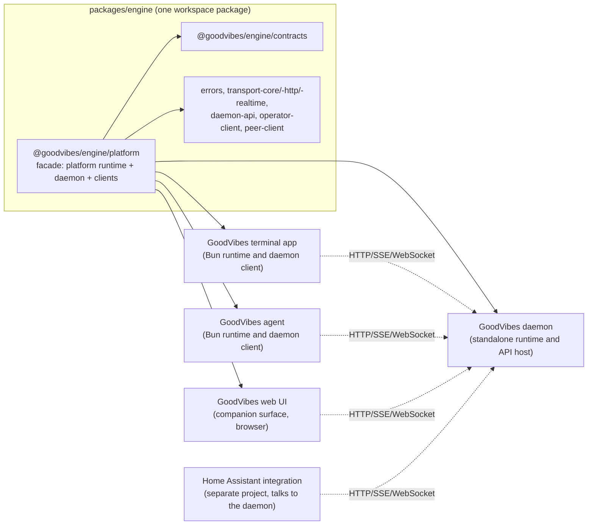

# GoodVibes engine

[](https://github.com/mgd34msu/goodvibes/actions/workflows/ci.yml)
[](https://opensource.org/licenses/MIT)

The engine is the typed TypeScript platform layer behind the GoodVibes products: sessions, provider/model routing, in-process agents, a knowledge and memory store, a control-plane HTTP and realtime API, and the transports that carry it all. The daemon is its own product, built on the engine. Full-surface consumers embed runtime behavior in a Bun process and connect to daemon services as clients. Companion consumers, including the WebUI and mobile clients, use HTTP, SSE and WebSocket. The workspace package `@goodvibes/engine` carries the platform through explicit subpaths such as `@goodvibes/engine/platform`, `@goodvibes/engine/contracts` and `@goodvibes/engine/errors`.

Use it to write your own client for GoodVibes: a script, a service, a browser
app or a phone companion that talks to a running daemon, or a Bun program that
hosts the runtime itself. To install and use GoodVibes, start at the
[repository README](../../README.md) and the
[installation guide](../../docs/installation.md). How the engine decides some
things your client will see is described with it:
[completion verification](docs/runtime-orchestration.md#completion-verification),
[project review inventory](docs/contract-criteria.md#project-review-inventory) and
[owner-configured tool access](docs/tool-safety.md#owner-configured-access).

## Getting it

`@goodvibes/engine` is not published to npm or any other package registry.

- **A client that talks to the daemon over HTTP needs no package.** The daemon's
  operator API is plain HTTP with a bearer token, plus Server-Sent Events and
  WebSocket for live updates. Its full description is the OpenAPI 3.1 document
  [`contracts/artifacts/operator-openapi.json`](./contracts/artifacts/operator-openapi.json)
  ([what it contains](./docs/openapi-contract.md)); the
  [daemon and control-plane routes](../../products/tui/docs/channels-remote-and-api.md#daemon-and-control-plane),
  [signing in](./docs/authentication.md) and
  [pairing a device](./docs/pairing.md) are described in their own pages, and an
  agent or script that only needs sessions, tasks, contracts, approvals and events
  can start from the [agent API index](./docs/agent-api-index.md). Any language
  that can send an HTTP request can be a client.
- **A client that wants the engine's typed TypeScript entry points** (the
  operator and peer clients, the contracts, the platform factories) gets them from
  a checkout of this repository at the release tag it targets (`git checkout
  v<version>`, then `bun install` and `bun run build` at the root, which builds
  the entry points), and depends on the engine as a workspace package:
  the client's own package sits under `products/` or `packages/` in that checkout
  (the folders the root `package.json` names as workspaces) and declares
  `"@goodvibes/engine": "workspace:*"`. Such a
  client is built against that release and is tied to it: the contract checks in
  the clients report a daemon of another version by method and field.
- **The reference clients** in this repository are written that way:
  [`products/tui/examples/reference-http-client`](../../products/tui/examples/reference-http-client/README.md)
  (a client of a running daemon) and
  [`products/tui/examples/reference-operator-client`](../../products/tui/examples/reference-operator-client/README.md)
  (the same calls against a fixture daemon, no network) import only
  `@goodvibes/engine/operator-client`, `@goodvibes/engine/peer-client`,
  `@goodvibes/engine/transport-core` and, for the fixtures,
  `@goodvibes/engine/contracts`, and resolve them through the terminal app's own
  workspace dependency (`products/tui/package.json`).

Public contract, config keys, route paths, event shapes, and file layouts follow the semver policy in `docs/semver-policy.md`. Pin exact versions and read `CHANGELOG.md` before upgrading.



---

## Talking to a daemon

Import only the declared entry points. For a Bun program (a CLI, a service, a
host of your own), the platform client factory talks to a reachable GoodVibes
daemon:

```ts
import { createGoodVibesPlatform } from '@goodvibes/engine/platform';
import { createMemoryTokenStore } from '@goodvibes/engine/platform/auth';

const platformClient = createGoodVibesPlatform({
  baseUrl: process.env.GOODVIBES_BASE_URL ?? 'http://127.0.0.1:3421',
  tokenStore: createMemoryTokenStore(process.env.GOODVIBES_TOKEN ?? null),
});

const snapshot = await platformClient.operator.control.snapshot();
```

Building a browser or web UI client instead, the companion entry point carries no Bun globals and bundles cleanly with Vite, webpack, and esbuild:

```ts
import { createBrowserGoodVibesPlatform } from '@goodvibes/engine/platform/browser';
import { createBrowserTokenStore } from '@goodvibes/engine/platform/auth';

const platformClient = createBrowserGoodVibesPlatform({
  baseUrl: 'https://goodvibes.example.com',
  tokenStore: createBrowserTokenStore(),
});

const stop = platformClient.realtime.viaSse().agents.on('AGENT_COMPLETED', (event) => {
  console.log('agent completed', event);
});
```

React Native, Expo, and Cloudflare Worker bridges follow the same pattern from their own subpaths. The canonical walkthrough for every runtime is [docs/getting-started.md](./docs/getting-started.md), and runnable versions of each are in [examples/](./examples/README.md).

---

## Entry point map

| Entry point | What it is |
| --- | --- |
| [`@goodvibes/engine/platform`](./platform) | The full platform runtime (sessions, agents, providers, knowledge, control plane, daemon route handlers) plus thin client factories for Bun, browser, React Native, Expo, and Cloudflare Workers. |
| [`@goodvibes/engine/contracts`](./contracts) | Runtime-neutral operator and peer contract artifacts, generated method IDs, and lookup helpers that the `platform` entry points and every client surface share. |

The same install also carries `errors`, `transport-core`, `transport-http`, `transport-realtime`, `daemon-api`, `operator-client`, `peer-client`, and `terminal-shell`, each imported as `@goodvibes/engine/<name>`; none is a separate install step. The full entry-point matrix is [docs/packages.md](./docs/packages.md).

### Entry points at a glance

| Entry point | Use it for |
| --- | --- |
| `@goodvibes/engine/platform` | Full Bun platform: client factory plus contracts, daemon, auth, operator, peer, and transports |
| `@goodvibes/engine/platform/daemon` | Daemon route dispatch and embedding helpers for a Bun server host |
| `@goodvibes/engine/platform/browser`, `/web` | Full browser and web UI client factories with the complete operator contract |
| `@goodvibes/engine/platform/react-native`, `/expo` | React Native and Expo client factories with mobile secure token stores |
| `@goodvibes/engine/platform/workers` | Cloudflare Worker bridge for daemon batch endpoints |
| `@goodvibes/engine/platform/contracts` | Runtime-neutral contract types, schemas, and method IDs |
| `@goodvibes/engine/platform/auth` | Token stores, login, and OAuth helpers, shared by every surface |

This is a starting point, not the full list. There is no root `@goodvibes/engine/platform/platform` entry and no `platform/*` wildcard export. The canonical, stability-leveled reference for every entry point is [docs/public-surface.md](./docs/public-surface.md).

---

## Key concepts

- **Two runtime surfaces.** Full (Bun: TUI, agent, daemon hosts) vs. companion (browser, React Native, Expo, Workers). See [docs/getting-started.md](./docs/getting-started.md) and [docs/surfaces.md](./docs/surfaces.md).
- **Public entry points.** The single canonical, stability-leveled list of every importable subpath: [docs/public-surface.md](./docs/public-surface.md).
- **Contracts.** The typed vocabulary (method IDs, endpoint IDs, event maps) every client and the daemon share: [docs/packages.md](./docs/packages.md).
- **Authentication.** Login, bearer tokens, and platform-specific secure token stores: [docs/authentication.md](./docs/authentication.md).
- **Realtime transports.** SSE and WebSocket with reconnect and typed, session-filtered event domains: [docs/realtime-and-telemetry.md](./docs/realtime-and-telemetry.md).
- **Knowledge and memory.** The SQLite-backed knowledge/wiki system, ingestion, retrieval, and project planning artifacts: [docs/knowledge.md](./docs/knowledge.md).
- **Provider and model runtime.** Daemon-side routing, failover, and catalogs across model providers: [docs/providers.md](./docs/providers.md).
- **Errors.** A typed `EngineErrorKind` model. Match on `err.kind`, never on `err.message`: [docs/error-kinds.md](./docs/error-kinds.md).
- **Hosted-turn cancellation is scoped to owned execution.** Its settlement boundary covers the turn's owned provider, tool, hook, and hook-Agent work. Independent workflow-trigger automations may continue; `TURN_CANCEL` is not a global “all side effects stopped” receipt. Uncooperative owned work must stay pending rather than be reported drained. See the [cancellation contract and platform limits](docs/hosted-turn-cancellation.md).

Full index: [docs/README.md](./docs/README.md).

---

## Release and stability

The engine carries the suite's version. What counts as a breaking change to
an entry point, a setting, a route or an event, and how much notice it gets, is in
[the semver policy](./docs/semver-policy.md); pin an exact version and read the
[changelog](./CHANGELOG.md) before upgrading. The suite itself is installed and
updated from checksum-verified release binaries by the
[repository installer](../../docs/installation.md#automatic-updates-and-rollback).

## Security

Report vulnerabilities through the repository [security policy](../../SECURITY.md).
Engine security boundaries and dependency posture are described in
[docs/security.md](./docs/security.md). Updating the installed suite installs
the selected release's checksum-verified binaries.

## License

MIT. See [LICENSE](./LICENSE).
