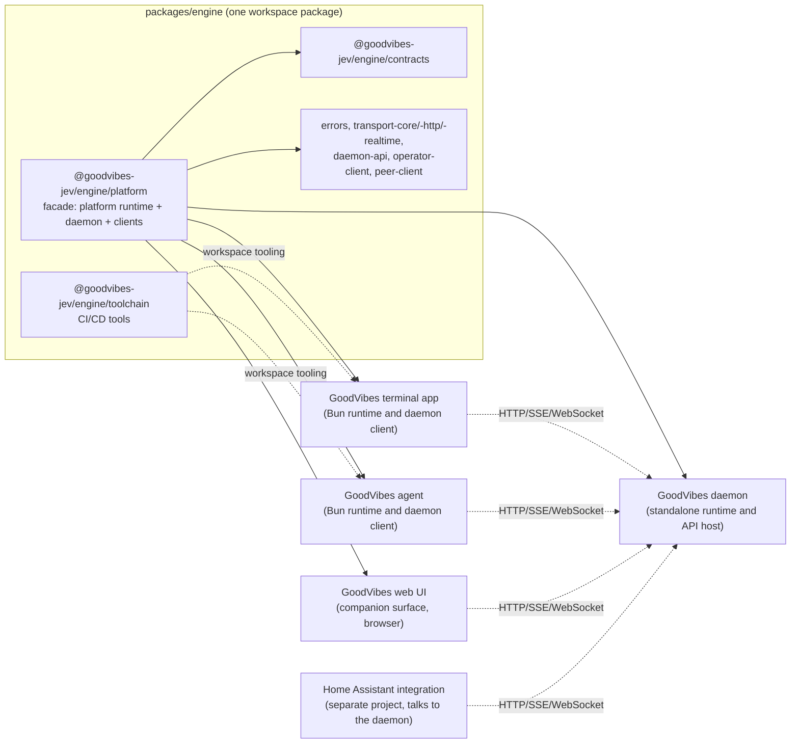

# GoodVibes engine

[](https://github.com/mgd34msu/goodvibes/actions/workflows/ci.yml)
[](https://opensource.org/licenses/MIT)

The engine is the typed TypeScript platform layer behind the GoodVibes products: sessions, provider/model routing, in-process agents, a knowledge and memory store, a control-plane HTTP and realtime API, and the transports that carry it all. The daemon is its own product, built on the engine. Full-surface consumers embed runtime behavior in a Bun process and connect to daemon services as clients. Companion consumers, including the WebUI and mobile clients, use HTTP, SSE and WebSocket. The workspace package `@goodvibes-jev/engine` carries the platform through explicit subpaths such as `@goodvibes-jev/engine/platform`, `@goodvibes-jev/engine/contracts` and `@goodvibes-jev/engine/errors`.

This page is for developers building on the engine. To install and use
GoodVibes itself, start at the [repository README](../../README.md) and the
[installation guide](../../docs/installation.md). Current behavior for
[completion verification](docs/runtime-orchestration.md#completion-verification),
[project review inventory](docs/contract-criteria.md#project-review-inventory) and
[owner-configured tool access](docs/tool-safety.md#owner-configured-access) lives
in the engine.

Public contract, config keys, route paths, event shapes, and file layouts follow the semver policy in `docs/semver-policy.md`. Pin exact versions and read `CHANGELOG.md` before upgrading.



---

## Install

Prepare the engine through the monorepo workspace:

```bash
# From the repository root:
bun install
bun run build
```

Products depend on `@goodvibes-jev/engine` through `workspace:*`; import only
declared entry points. For a Bun host (terminal app, agent, CLI, daemon), the platform
client factory talks to a reachable GoodVibes daemon:

```ts
import { createGoodVibesPlatform } from '@goodvibes-jev/engine/platform';
import { createMemoryTokenStore } from '@goodvibes-jev/engine/platform/auth';

const platformClient = createGoodVibesPlatform({
  baseUrl: process.env.GOODVIBES_BASE_URL ?? 'http://127.0.0.1:3421',
  tokenStore: createMemoryTokenStore(process.env.GOODVIBES_TOKEN ?? null),
});

const snapshot = await platformClient.operator.control.snapshot();
```

Building a browser or web UI client instead, the companion entry point carries no Bun globals and bundles cleanly with Vite, webpack, and esbuild:

```ts
import { createBrowserGoodVibesPlatform } from '@goodvibes-jev/engine/platform/browser';
import { createBrowserTokenStore } from '@goodvibes-jev/engine/platform/auth';

const platformClient = createBrowserGoodVibesPlatform({
  baseUrl: 'https://goodvibes.example.com',
  tokenStore: createBrowserTokenStore(),
});

const stop = platformClient.realtime.viaSse().agents.on('AGENT_COMPLETED', (event) => {
  console.log('agent completed', event);
});
```

React Native, Expo, and Cloudflare Worker bridges follow the same pattern from their own subpaths. The canonical walkthrough for every runtime is [docs/getting-started.md](./docs/getting-started.md), and runnable versions of each are in [examples/](./examples/README.md).

---

## Entry point map

| Entry point | What it is |
| --- | --- |
| [`@goodvibes-jev/engine/platform`](./platform) | The full platform runtime (sessions, agents, providers, knowledge, control plane, daemon route handlers) plus thin client factories for Bun, browser, React Native, Expo, and Cloudflare Workers. |
| [`@goodvibes-jev/engine/toolchain`](./toolchain) | The CI/CD toolchain: release cut, npm publish, per-job-green verification, and coverage checks. Invoked as `bunx @goodvibes-jev/engine/toolchain <tool>` from every GoodVibes repo's release workflow. |
| [`@goodvibes-jev/engine/contracts`](./contracts) | Runtime-neutral operator and peer contract artifacts, generated method IDs, and lookup helpers that the `platform` entry points and every client surface share. |

The same install also carries `errors`, `transport-core`, `transport-http`, `transport-realtime`, `daemon-api`, `operator-client`, `peer-client`, and `terminal-shell`, each imported as `@goodvibes-jev/engine/<name>`; none is a separate install step. The full entry-point matrix is [docs/packages.md](./docs/packages.md).

### Entry points at a glance

| Entry point | Use it for |
| --- | --- |
| `@goodvibes-jev/engine/platform` | Full Bun platform: client factory plus contracts, daemon, auth, operator, peer, and transports |
| `@goodvibes-jev/engine/platform/daemon` | Daemon route dispatch and embedding helpers for a Bun server host |
| `@goodvibes-jev/engine/platform/browser`, `/web` | Full browser and web UI client factories with the complete operator contract |
| `@goodvibes-jev/engine/platform/react-native`, `/expo` | React Native and Expo client factories with mobile secure token stores |
| `@goodvibes-jev/engine/platform/workers` | Cloudflare Worker bridge for daemon batch endpoints |
| `@goodvibes-jev/engine/platform/contracts` | Runtime-neutral contract types, schemas, and method IDs |
| `@goodvibes-jev/engine/platform/auth` | Token stores, login, and OAuth helpers, shared by every surface |

This is a starting point, not the full list. There is no root `@goodvibes-jev/engine/platform/platform` entry and no `platform/*` wildcard export. The canonical, stability-leveled reference for every entry point is [docs/public-surface.md](./docs/public-surface.md).

---

## Key concepts

- **Two runtime surfaces.** Full (Bun: TUI, agent, daemon hosts) vs. companion (browser, React Native, Expo, Workers). See [docs/getting-started.md](./docs/getting-started.md) and [docs/surfaces.md](./docs/surfaces.md).
- **Public entry points.** The single canonical, stability-leveled list of every importable subpath: [docs/public-surface.md](./docs/public-surface.md).
- **Contracts.** The typed vocabulary (method IDs, endpoint IDs, event maps) every client and the daemon share: [docs/packages.md](./docs/packages.md).
- **Authentication.** Login, bearer tokens, and platform-specific secure token stores: [docs/authentication.md](./docs/authentication.md).
- **Realtime transports.** SSE and WebSocket with reconnect and typed, session-filtered event domains: [docs/realtime-and-telemetry.md](./docs/realtime-and-telemetry.md).
- **Knowledge and memory.** The SQLite-backed knowledge/wiki system, ingestion, retrieval, and project planning artifacts: [docs/knowledge.md](./docs/knowledge.md).
- **Provider and model runtime.** Daemon-side routing, failover, and catalogs across model providers: [docs/providers.md](./docs/providers.md).
- **Errors.** A typed `EngineErrorKind` model. Match on `err.kind`, never on `err.message`: [docs/error-kinds.md](./docs/error-kinds.md).
- **Hosted-turn cancellation is scoped to owned execution.** Its settlement boundary covers the turn's owned provider, tool, hook, and hook-Agent work. Independent workflow-trigger automations may continue; `TURN_CANCEL` is not a global “all side effects stopped” receipt. Uncooperative owned work must stay pending rather than be reported drained. See the [cancellation contract and platform limits](docs/hosted-turn-cancellation.md).

Full index: [docs/README.md](./docs/README.md).

---

## Development

```bash
git clone https://github.com/mgd34msu/goodvibes.git
cd goodvibes
bun install
bun run build
```

| Command | Does |
| --- | --- |
| `bun run build` | Build judgment, engine and all four products from the monorepo root |
| `bun run test` | Run every default-suite test file in the repository (engine, judgment, installer, products) from one pool |
| `bun run validate` | Run the local integration gate: build/types, API/contracts, exports, packaging and runtime checks |
| `bun run api:extract` / `bun run api:check` | Regenerate / verify the API Extractor reports under `etc/*.api.md` |
| `bun run refresh:contracts` | Regenerate shared contract artifacts and product snapshots after a contract change |
| `bun run docs:generate` / `bun run docs:check` | Regenerate / verify API reference docs; the check also verifies required docs and examples exist |

### Running tests

Every test file runs through one runner, `packages/engine/scripts/test.ts`.
Each file runs in its own `bun test` process with its own home and temp
directory, provider credentials removed from the environment and the network
blocked, from one pool of workers (cores minus one; `--jobs <n>` sets it).

The limits are fixed; no flag, variable or bunfig setting raises them: 5
seconds per test, 10 seconds per file (30 under `test/live/` and
`src/test/e2e/`), and 600 file-seconds for the default suite. A file past its
limit is killed and reported as failed. Before any file starts, the runner
parses every selected file and refuses the whole run, naming file and line, if
one sleeps (`Bun.sleep`, a promise resolved by `setTimeout`, a timer from
`timers/promises`), uses a snapshot, calls `mock.module`, skips a test (`.skip`,
`.todo`, `.skipIf`, `xit`) or passes a timeout, retry or `setDefaultTimeout`. A
file that runs no test, skips one at run time, tries the network or leaves a
process running is a failure. The run ends with the ten slowest files, the
file-seconds per group and a line of files run, passed, failed and refused.

```bash
# Every default-suite file in the repository
bun run test

# One file, or the default-suite files under a folder (relative to the
# current directory, else to packages/engine; --cwd sets another base)
bun run test:one test/mailbox-one-reader.test.ts
bun packages/engine/scripts/test.ts products/agent/src/test

# The files under test/live/ (the sandbox proofs; a host without bubblewrap
# fails them) and under src/test/e2e/ (the built binaries), with their own totals
bun packages/engine/scripts/test.ts --live
bun packages/engine/scripts/test.ts --e2e
```

`-t <pattern>` runs only the tests whose name matches. Each package's
`bun run test` runs that package's files. TUI and Agent tests create their
working directories under `<product>/.test-tmp/run-*`, which is ignored by Git.

Plain `bun test <file>` skips the runner's isolation, limits and admission
scan, and the tests that start daemon fixture processes refuse to run without
the runner.

### Continuous integration

`.github/workflows/ci.yml` runs on every push to `main`, every pull request
against it, and by hand. Each job but the audit and the native builds runs
`bun run validate --job <job>`, so `bun run validate` locally runs the same
commands in the same order. One `build` job produces the workspace output and
the jobs that read it restore it instead of rebuilding.

| Job | Runs |
| --- | --- |
| `gates` | The source-only checks: errors, products, credential scope, judgment lint, events, version, flag graduation, internal ids, architecture, platform console, no `any`, the admission scan of the web UI's browser journey files, contracts, the web UI's engine imports, the release asset scripts |
| `build` | `bun run build` once (the web UI build checks its committed settings-schema snapshot first) |
| `journeys` | `bun run journeys`: the sixteen product run-throughs from source, each in an isolated home on loopback, with bubblewrap and the web UI's Playwright Chromium |
| `typecheck` | The test, type-test, installer and product projects against the built declarations; API reports, exports, examples, browser compatibility, package metadata |
| `proofs` | `bun run test` |
| `live-sandbox` | `bun run test:live` inside real bubblewrap, where a skip fails |
| `measure` | `bun run measure:check` against the recorded budgets |
| `package` | Pack, publint, install smoke, packaged-artifact conformance and bundle sizes; the three Linux programs built, the built-program smoke files, the web UI's browser journeys against its production build, the daemon inside bubblewrap and the web UI against a real daemon; then no file in the checkout may have changed |
| `security-audit` | Dependency audit and secret scan |
| `native` | Pushes to `main` and manual runs, not pull requests: the daemon built and run on Linux ARM, macOS Intel and macOS ARM, and on macOS its launchd service started, restarted and stopped in the logged-in session's domain |
| `ci-ok` | Fails unless every job succeeded (`native` may be skipped on a pull request); the release requires it on the release commit |

Workflows install the Bun version named by `engines.bun` in the root
`package.json` through the `.github/actions/bun` action; change the version
there. Release workflows derive the previous release tag from Git history.

---

## Release and stability

The monorepo owns versioning and release workflows. The root version governs
the engine, judgment and daemon; the other product manifests retain their own
versions. The application products are private workspaces; the suite is
installed from checksum-verified release binaries by the repository installer. Export and compatibility rules are recorded in
[the semver policy](./docs/semver-policy.md); release machinery and its explicit
gates are described in release and publishing.
Update an installed suite with the [repository installer](../../docs/installation.md#automatic-updates-and-rollback).

## Security

Report vulnerabilities through the repository [security policy](../../SECURITY.md).
Engine security boundaries and dependency posture are described in
[docs/security.md](./docs/security.md). Updating the installed suite installs
the selected release's checksum-verified binaries.

## License

MIT. See [LICENSE](./LICENSE).
