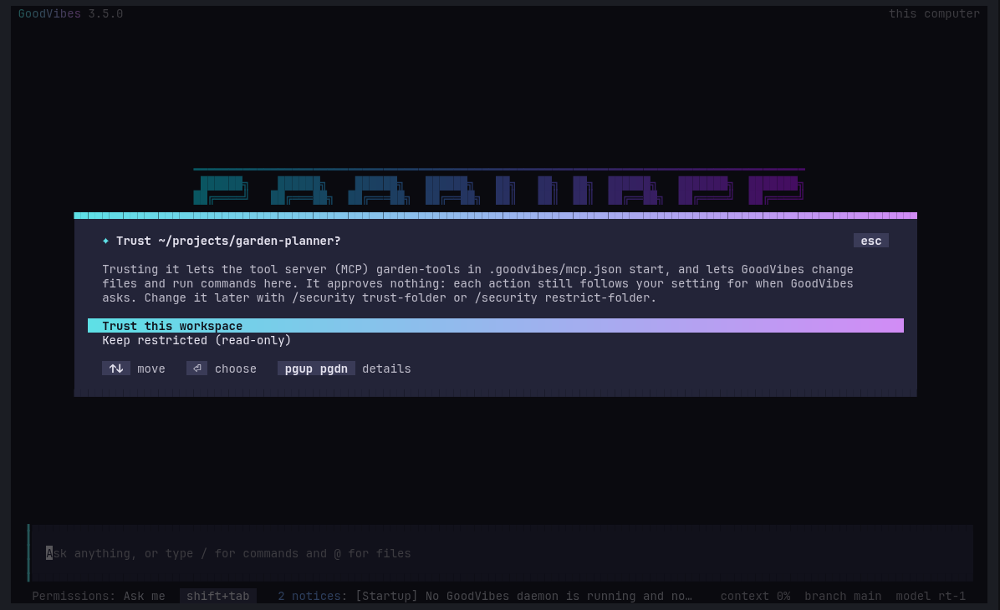
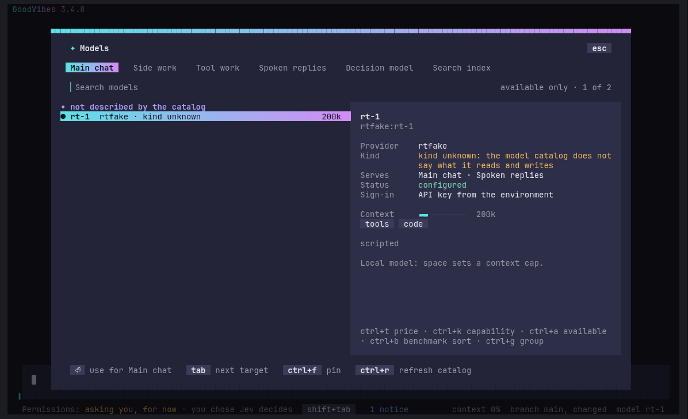

# GoodVibes terminal app (`goodvibes`)

[](https://opensource.org/licenses/MIT)

`goodvibes` is the GoodVibes terminal app for working in a project. You run `goodvibes` in a project directory and get a full-screen terminal app where you talk to a model that can read and edit your files, run shell commands and tests, search the web, and hand work off to helper agents. Reads and edits inside the project just happen; how often it stops to ask you about the rest is a setting (see [How much it asks you](../../README.md#how-much-it-asks-you)).

It talks to many model providers (OpenAI, Anthropic, Gemini, Bedrock, Copilot, OpenRouter and other OpenAI-compatible gateways, plus local servers like Ollama and LM Studio that `/scan` finds on your machine and LAN), keeps its settings, sessions, and secrets on your own machine, and shows you the token count and running cost of every turn. Background work opens in large modals over the conversation: running agents, changed files and diffs, tokens and cost.


## Install and start

Install with the [suite installer](../../docs/installation.md), which installs this app together with the personal assistant (`goodvibes-agent`), the daemon and the web UI:

```sh
curl -fsSL https://goodvibes.sh/install.sh | sh
```

Then run `goodvibes` in a project directory. When no model is ready, the first run takes three steps: choose how to get a model (a ChatGPT subscription, an API key for Anthropic, OpenRouter or another provider, or a model server found on this computer), sign in or paste the key, and start the conversation with three starting prompts for the folder. `/setup` sets up everything else one topic at a time, and its `Run first-run again` opens the three steps again. The [getting started guide](docs/getting-started.md) covers providers and keys in full. How often you are asked, and the optional decision model, are explained in the [decision-model policies](../../docs/decision-model-policy.md).

---

## A 60-second tour

### The conversation loop


Tool calls stream inline as the model makes them, then their results fold into a collapsible group so a long working session stays readable. Expand any group to see what actually came back. Assistant messages render markdown, syntax-highlighted code, and inline diffs, and any block can be collapsed, bookmarked, copied, or saved to a file.

The footer keeps an honest running total: fresh input tokens separated from cache reads, output tokens, the estimated cost so far, and how much of the context window is used. When a model's price is not in the catalog, the cost is reported as unavailable rather than guessed.

### Permissions and workspace trust



The first time you open a directory, GoodVibes asks how much it is allowed to do there. Restricted is read-only. The model can look around, but writes and commands are refused until you trust the workspace. Until then a `hooks.json` in the workspace is not loaded and the MCP servers its `.mcp/mcp.json` or `.goodvibes/mcp.json` name do not start. The decision is kept in your own workspace register; a project cannot mark itself trusted. `/security trust-folder` changes it later.


After that, reads, searches, edits inside the workspace and commands a saved rule covers start at once. What only you decide (granting access, loosening a security, judgment or payment setting, a call your own "always ask me" rule covers, a change asked for from a channel, a deletion nothing keeps a copy of, sending to a new recipient, sending content derived from untrusted text, and changing what a contract requires) comes to you in every mode but `yolo` (asked, or held for the end of the run in `just-vibes`), and Jev never answers it; purchases over your limits come to you through the payment windows. Everything else is a judgment call, and `permissions.mode` decides who answers it. The default is `jev-decides`: Jev, the decision model, decides judgment calls, and with no working decision model you are asked instead. When you are asked, the card is a question in a sentence (`Run this command?`, `Change a file outside this folder?`), with the folder on the right, what it acts on (the whole command, the paths, the change), and one sentence saying what it will do. Only a call that cannot be undone is shown in red, with `This can't be undone.` You can allow it once (`y`), deny it (`n`, or start typing a reason the model sees), or remember the decision (`a`) at whichever scope fits: this exact command, this command shape, this path, this tool, or just for the rest of the session. Enter presses the selected button, which is `No` for anything that cannot be undone and for money spent or a message sent as you; nothing that cannot be undone can be remembered.

The other modes:

- `ask-me`: Jev reads each judgment call's risk; calls it reads as critical, irreversible or security-weakening ask you, and the rest run
- `just-vibes`: nothing interrupts you; anything that needs you is held and listed at the end of the run, and `/held` approves or sets it aside
- `yolo` runs every action without approval prompts, except a change asked for from a channel (authentication, containment, secret storage and payment limits still apply, and an act only you perform is refused to the model)
- `plan` allows read-only tools and refuses every mutating or exec call

`/decisions` lists what Jev decided for you, with undo, never, always and ask. An explicit `permissions.tools.<name>` set to `deny` blocks that tool. Older saved values still load: `safe-owner`, `prompt`, `normal`, `accept-edits` and `custom` as `ask-me`, `safe-jev` and `auto` as `jev-decides`, `allow-all` as `yolo`. How the mode combines with the decision model setting is in [decision-model policies](../../docs/decision-model-policy.md#how-much-you-are-asked).

`Shift+Tab` cycles the mode for the current session only, and asks before switching to `yolo`; the saved default is set in `/settings` (Permission Mode), and `--just-vibes` or `--yolo` picks one for a single launch. `/plan` toggles plan mode directly.

### Models and providers



Models come from a live catalog, so the picker lists far more than a hardcoded set, filterable by search, price, capability, and availability. Separate roles route independently: your main chat model, a cheaper helper model for grunt work, a tool model, a TTS model, and an embeddings model can each point somewhere different.

The `synthetic` provider groups the same model across every backend that serves it into one entry. Pick it and requests route to whichever backend is healthy, failing over on rate limits and transient errors without changing the model you chose, and without ever crossing the free, paid, and subscription boundaries. Any OpenAI-compatible API can be added as a custom provider by dropping a JSON file in `~/.goodvibes/tui/providers/`. It is hot-reloaded. See [docs/providers-and-routing.md](docs/providers-and-routing.md).

### Your agents


Work that is not conversation opens in modals instead of scrolling past in the transcript. Your agents, opened with `F2`, `Ctrl+O` or `/agents`, is the same panel in this app and in the Agent. It lists what is waiting for you first (the agent and what it asks; Enter brings its card to the front), then each running agent with what it is doing, the agents that finished this session, and what is scheduled, with the platform's own background services behind one line (`Background services  N healthy ›`) and an unhealthy one listed by itself. You can open a running agent to watch its live tail or steer it, back out with `Esc` without stopping it, stop it and what it started with `s` or `Ctrl+X` (it asks first), start a new one with `n`, pause or resume a schedule with `p`, and archive finished work. Usage (`/usage`) shows context pressure, tokens and cost; Changes (`/changes`) shows changed files with a tinted diff, a semantic summary, hunk staging and review comments; Notifications (`/notifications`, or `Ctrl+N`) keeps every notice. Notices no longer take over the status bar: they wait in a count there (`2 notices`).

### Everything else is a command


Press `?` on an empty prompt, `Ctrl+P` or `/help` for one searchable list of everything you can do: every command, view and setting, with the keyboard shortcuts at the end. Every slash command is guided: typing it alone opens a short list of what it can do, and an action with blanks opens a form that shows the line it will run. Each command has one name and no short aliases. The same list is generated into [docs/commands-reference.md](docs/commands-reference.md); the commands this release removed or renamed are listed in the [3.3.2 release notes](../../docs/releases/3.3.2.md#removed-and-renamed-commands).

### Keys worth knowing on day one

| Key | Does |
| --- | --- |
| `Enter` / `Shift+Enter` | Send the message / insert a newline |
| `?` | The list of every command and key (on an empty prompt) |
| `@` | File picker: insert a path into the prompt |
| `Tab` | Complete a path, or toggle collapse on the nearest block. With the session chips showing and an empty composer, switch to the next session |
| `Ctrl+F` | Search the conversation |
| `Ctrl+Y` / `Ctrl+S` | Copy / save the nearest block |
| `Ctrl+P` / `Ctrl+K` | The same list as `?`: search and run any command, view or setting |
| `F2` / `Ctrl+O` | Open or close Your agents |
| `Ctrl+N` | Open the notices the status bar counts |
| `Alt+R` / `Alt+O` / `Alt+I` | On a failed turn: try again, use another model, show the details |
| `Shift+Tab` | Cycle this session's permission mode (asks before `yolo`; the saved default is unchanged). With the session chips showing and an empty composer, switch to the previous session |
| `Esc` | Close the top modal (one level), clear the composer, leave an agent or process view (never stops it), or interrupt main's turn |
| `Ctrl+X` | Inside an agent or process view: stop it (press twice to confirm) |
| `Ctrl+C` | Clear input, cancel a running turn. Press twice to quit |

Most bindings are customizable in `~/.goodvibes/tui/keybindings.json`, and `/help keys` shows what is currently bound. Four keys are fixed and stay out of that file: `F2` (Your agents), `Esc` (leave the current mode), `?` (help), and `@` (file picker). The permission-mode cycle (`Shift+Tab`) is the rebindable `cycle-permission-mode`. The full reference is in [docs/tools-and-commands.md](docs/tools-and-commands.md).

---

## What's in the box

Each row links to the page that documents it. The product's own `?` list (`/help`) is always the current authority.

| Area | What you get | Docs |
| --- | --- | --- |
| Models and routing | Native, OpenAI-compatible, and gateway providers; local inference-server discovery; synthetic failover groups; per-role model targets; custom provider JSON | [providers-and-routing.md](docs/providers-and-routing.md) |
| Tools | File read/write/edit/find, shell exec, fetch, web search, code analysis and inspection, agents, workflows, bounded REPL/query runtimes | [tools-and-commands.md](docs/tools-and-commands.md) |
| Slash commands | The full generated command reference, by category | [commands-reference.md](docs/commands-reference.md) |
| Keyboard | The complete binding reference, and how to rebind | [tools-and-commands.md](docs/tools-and-commands.md) |
| Agents and workflows | Built-in and custom archetypes, spawning, git worktree isolation, automation and scheduled jobs | [tools-and-commands.md](docs/tools-and-commands.md) |
| Extending it | Hooks and hook chains, the plugin manifest and API, MCP servers, the curated marketplace | [tools-and-commands.md](docs/tools-and-commands.md) |
| Diagnostics | Evaluation suites, deterministic replay, failure reports (`/health`), telemetry | [tools-and-commands.md](docs/tools-and-commands.md) |
| CLI flags | Session lifecycle (`--continue`, `--resume`, `--fork`), non-interactive mode, output formats, host selection | [cli-flags.md](docs/cli-flags.md) |
| Knowledge and memory | Session and durable memory, a structured knowledge store with connectors and extractors, embeddings and retrieval, artifacts, multimodal analysis | [knowledge-artifacts-and-multimodal.md](docs/knowledge-artifacts-and-multimodal.md) |
| Session durability | Saved session after every turn plus a crash snapshot at each turn moment, offered at the next start | [session-durability.md](docs/session-durability.md) |
| Planning | Conversational planning loop, project-scoped knowledge spaces, readiness evaluation, the Planning modal | [project-planning.md](docs/project-planning.md) |
| Sharing and export | `/session save-file` and `/session upload` to HTML, JSON, or Markdown with redaction, a Gist link, and clipboard options | [share-command.md](docs/share-command.md) |
| Daemon and services | Connecting to the standalone GoodVibes daemon, browser operator surface, background service and autostart, inbound TLS, outbound trust | [deployment-and-services.md](docs/deployment-and-services.md) |
| Remote access | A worked home-server setup: always-on daemon, browser access, TUI over SSH, reachability and TLS | [remote-access.md](docs/remote-access.md) |
| Channels and API | Slack, Discord, Telegram, Matrix, webhook and other surfaces; the shared reply pipeline; remote peers and node hosts; the control-plane HTTP and streaming API | [channels-remote-and-api.md](docs/channels-remote-and-api.md) |
| Voice | Live spoken answers (`/voice`), TTS and STT providers, streaming voice API | [voice-and-live-tts.md](docs/voice-and-live-tts.md) |
| Integrations | Home Assistant surface, Cloudflare Workers/Queues batch, GitHub Action | [homeassistant-surface.md](docs/homeassistant-surface.md) · [cloudflare-batch.md](docs/cloudflare-batch.md) · [github-action.md](docs/github-action.md) |
| Contributing surfaces | The checked-in operator/peer contracts and knowledge schemas | [foundation-artifacts](docs/foundation-artifacts/README.md) |

Full index: [docs/README.md](docs/README.md).

---

## Configuration

Settings are layered. Later layers win:

1. built-in defaults
2. global settings: `~/.goodvibes/tui/settings.json`
3. project overrides: `.goodvibes/tui/settings.json`
4. CLI and runtime overrides

Edit them live with `/settings` rather than by hand. A few of the most-reached-for keys:

| Key | Default | What it does |
| --- | --- | --- |
| `permissions.mode` | `jev-decides` | `ask-me`, `jev-decides`, `just-vibes`, `yolo`, or `plan` |
| `judgment.policy` | `Hybrid` | `Hybrid`, `Decision Model Only`, or `No Decision Model` |
| `provider.model` | `openrouter:openrouter/free` | Active model for main chat |
| `provider.reasoningEffort` | `medium` | Reasoning depth on models that support it |
| `display.theme` | `goodvibes` | Color theme |
| `display.stream` | `true` | Stream responses token by token |
| `display.lineNumbers` | `off` | Line numbers: `off`, `code`, or `all` |
| `display.showThinking` | `false` | Show model thinking traces |
| `behavior.autoCompactThreshold` | `80` | Context percentage before auto-compact runs |
| `helper.enabled` | `false` | Route grunt work to a cheaper helper model |
| `daemon.enabled` | `true` | Adopt a local session daemon on loopback; off makes no adoption attempt |

The wider key table, the permission modes, and the hand-edited TUI namespaces (checkpoint root guard, scriptable statusline, session behavior, launch-time self-update) are in [docs/configuration.md](docs/configuration.md).

### Where things are stored

Everything lives in plain files, split between the per-user `~/.goodvibes/tui/` tree and the project's own `.goodvibes/` directory:

| Path | What lives there |
| --- | --- |
| `~/.goodvibes/tui/settings.json` | Global settings |
| `.goodvibes/tui/settings.json` | Project settings overriding the global layer |
| `~/.goodvibes/tui/secrets.enc` or `.goodvibes/tui/secrets.enc` | Encrypted secrets, global or per project |
| `~/.goodvibes/tui/providers/*.json` | Custom provider definitions, hot-reloaded |
| `~/.goodvibes/tui/keybindings.json` | Keybinding overrides |
| `~/.goodvibes/tui/services.json` | The service registry (a project's `.goodvibes/tui/services.json` adds only services whose credentials are keys in your secret store) |
| `.goodvibes/tui/automation-*.json` | Scheduled jobs and the rest of the automation store |
| `.goodvibes/agents/*.md` | Agent archetypes |
| `.goodvibes/mcp.json` | MCP server definitions (a project's start only once the workspace is trusted) |
| `hooks.json` (project root) | Hooks and hook chains (loaded only once the workspace is trusted) |
| `.goodvibes/` (rest) | Sessions, artifacts, and other project runtime state in the working directory |

---

## A note on cost

Free-tier synthetic models can cascade to the next-best free model when every backend for the current one is exhausted, and free, paid, and subscription tiers are never mixed. This system is not perfect, and there are ways it could result in charges accruing.

This includes but is not limited to when a provider moves a model from free to paid and you have kept the session running for longer than 24 hours without refreshing the model list. The system will not know that the model is now a paid model.

Refreshes happen automatically when a new session is started or resumed after the 24-hour catalog TTL expires. For long-running sessions, please ensure that the models are refreshed daily.

Paid and subscription models never move to a model you did not choose. A failed model is tried again only as the same model on another sign-in of its provider (OpenAI: the subscription, then the API key), and then only as the models you list in `provider.fallbackModels`, in your order; with none listed, the turn stops and says why. When every backend of a paid synthetic model is exhausted, GoodVibes says so and offers to wait out the cooldown, change model, or move to a free model. Full failover behavior: [docs/providers-and-routing.md](docs/providers-and-routing.md).

---

## Reference

The sections below describe specific commands in detail.

### Purchase approval and veto windows

Type `/payments pending` in the owner terminal to read purchase notices from
the selected paired daemon. Select a purchase, read its notice and deadline,
then choose approve/deny or proceed-now/cancel. The menu retains that host and
window reference; changing the connection requires reopening it. Escape closes
the local view. An answer already sent may still complete on the host.

This requires a paired administrative credential with `read:payments` and
`write:payments`. `/payments` opens its list of actions. "Add a card" asks for
the card field by field, each hidden, and sends it to the selected daemon in one
`payments.cards.create` request; "See your cards" (`/payments cards`) lists the
cards the daemon holds (label, kind, brand, last four digits, expiry; never the
number, CVV or name).

### Native work controls (local Jev implementation)

`/work open` discovers the authenticated daemon's native project without legacy
planning lookup; `/work open <daemon-project-id>` selects it explicitly.
In the Native Work modal, select a work item's control row: `s` starts, `i`
inspects status, `c` cancels, and `r` explicitly resumes. The row names the
attempt targeted by status/cancel; execution progress paints without a new key.

Start/resume require an existing active attempt and the daemon's current paired
operator authority. Execution controls do not create work or edit original criteria. Explicit source
submission and conversational intake are described below. Opening a view never starts or resumes
execution. Status/cancel retain the last observed attempt across a handoff within
that view; older attempts cannot be rediscovered after reopening this surface.

Reported work state, verified evidence, execution progress, admitted/current
revisions and recovery state remain distinct. A lost response leaves the server
outcome unknown. Closing or replacing host, token or workspace only aborts local
requests and discards their results; use Cancel to request host cancellation.
Pending and refused admissions, and cancellation before admission, have no
execution receipt or progress. They display requested revisions, separately from
admitted executions. Refused/interrupted admission recovery requires explicit
resume; a cancelled intent requires a new native attempt.
No control asks for owner approval or automatically retries/resumes execution.

### Conversation input

Composer messages and `goodvibes --prompt '<text>'` go directly to the selected
conversation model. Jev does not approve, reject or reroute these messages.
Messages submitted during a response are queued. Composer file references,
paste content and supported images are passed through to the conversation.

### Terminal workstream intake

`/workstream start <request>` explicitly submits to native work intake.
Jev determines the native outcome; the command name does not force
work admission. Admitted work enters the existing native execution flow, while an
ordinary turn requires its durable dispatch claim and native turn permit. There is
no legacy runner fallback when native intake, the paired host or the journal is
unavailable.

The terminal captures the command before trimming, splitting or source expansion.
The command tokens and one whitespace separator after `start` are syntax (CRLF
counts as one separator). Everything after that separator is the exact request,
including extra leading spaces, trailing whitespace, line breaks and Unicode.
File/context references and folded paste/image markers remain declared unsupported
sources; they are not expanded into replacement owner authority. Generic, model
and nested command invocations cannot submit a new owner request.

Use `/work intake`, `/work intake-retry`, `/work intake-resume` and
`/work intake-cancel` to inspect or recover the retained native input. Uncertain
writes retain the original request IDs and source; repeated submission while
pending cannot replace them. Host/principal changes and late cancelled results
cannot dispatch stale local turns.

`/workstream list`, `status`, `stop` and `answer` continue to address historical
legacy contract IDs. They do not inspect or cancel newly admitted native work;
use `/work` for native execution status and cancellation.

### Explicit native source submission

Both products use the same command contract:

- `/work submit-file <path>` reads a regular UTF-8 JSON file containing exactly
  `goal` (a string) and `criteria` (an ordered array of strings).
- `/work submission` looks up the retained request without writing work.
- `/work submission-retry` first looks up that same request. Only a `not-found`
  result can lead to replay of the exact retained request.
- `/work submission-discard` first looks up that same request. When the host
  has it, its receipt is shown and nothing is dropped; otherwise the retained
  request is removed and nothing is sent, so a corrected source can be
  submitted.

Example source file:

```json
{"goal":"  Deliver the original goal\nwithout rewriting it  ","criteria":["First criterion","Second criterion","First criterion"]}
```

Decoded goal/criterion strings are preserved verbatim, including whitespace,
line breaks, order and duplicates. No model generates or changes criteria.
Blank/whitespace-only values and missing criteria are rejected locally. Each
string is limited to 20,000 UTF-16 code units; 1–100 criteria are required. Both
the source file and complete encoded submission must fit 262,144 UTF-8 bytes.
For paths containing spaces, use a file URL such as
`file:///tmp/my%20source.json`, which survives both slash-command parsers.

Initial submission generates request/input IDs and captures the live whole-ledger
revision once. Before sending, the app durably publishes the exact source, IDs and
revision in its private `native-work-submission.json` journal under its product
state directory. The journal binds each request to the exact daemon endpoint,
canonical workspace, project and live server-verified paired principal. It stores
no bearer token. The journal has no record cap; the file is bounded at 2 MiB. A
binding is removed once its submission has a validated receipt, or when
`submission-discard` drops it after the host reported it does not have it; one
whose outcome is not yet known is never evicted. Corrupt, oversized,
symlink-backed or unconfirmable state fails closed without a submission.

After a restart, use `submission` or `submission-retry` to recover the
original request. Both first look it up using that same identity. Retry does not
reread the source file, generate new IDs or refresh the revision. Only an explicit
retry after `not-found` can send the identical durably confirmed request. A
`not-found` lookup is not proof that a lost in-flight request cannot still arrive.
A persistence failure sends nothing and retains any uncertain journal publication
for inspection/recovery; it never deletes or silently replaces that identity.
Changing credentials to another principal cannot replay the old principal's
journal. Host, token, project and canonical-workspace changes or cleanup discard
in-flight results; overlapping submission commands remain single-flight.

A definite stale-ledger conflict permits an explicitly new `submit-file` command
to capture a new identity/revision. An unresolved retained request must be looked
up before submitting a new source. Submission/replay never starts execution.

Submission requires an existing paired operator with native ledger read/write
scopes. It never grants scopes, stores credentials or starts execution. The
receipt identifies the created work/current attempt and preserves the original
source; inspect `/work` and use its separate explicit Start control.

### TUI host credentials

Native `/work`, headless intake and legacy-import reads use a TUI-owned device credential bound to the exact configured daemon origin when there is one. For the daemon on this machine (a loopback origin whose operator token file is yours) no pairing is needed: the TUI presents the operator token it already holds, and the daemon treats it as the owner's own machine. For a daemon on another machine, review `goodvibes host pair --bootstrap-shared` in an owner terminal; add `--apply` only after reviewing the persistent administrative scope. Use `--url <origin>` for a one-command endpoint override. `/devices pair host` shows what that pairing would do, and with `--apply` reviews and confirms it in this terminal; companion pairing is `/devices pair device`. See [host pairing and recovery](docs/host-pairing.md).

---

## Development

```sh
git clone https://github.com/mgd34msu/goodvibes.git
cd goodvibes
bun install
bun run build
bun run --cwd products/tui dev
```

Run these commands from `products/tui` after preparing the monorepo:

| Command | Does |
| --- | --- |
| `bun run dev` | Run the TUI from source |
| `bun run test` | Run this product's tests except `src/test/e2e/` through the shared runner, `packages/engine/scripts/test.ts` (`bun run test:e2e` runs the end-to-end files) |
| `bun run build` | Compile the selected target, such as `dist/goodvibes-linux-x64` |

The compiled binary is the TUI entrypoint. With `daemon.enabled` on (the default) it adopts a running standalone GoodVibes daemon over loopback, and when a daemon is installed as a service but stopped, it starts that service once and waits for it to come online. It never embeds or constructs a daemon of its own. The control plane, HTTP listener (`danger.httpListener`), and web surface are all hosted by the daemon; the TUI configures them and reports their bindings.

Tests live under `src/test/`, mirroring the source tree. End-to-end tests under `src/test/e2e/` drive the compiled binary in a real terminal against a scripted model. To run one file, pass it to the runner from the repository root: `bun run test:one products/tui/src/test/<file>.test.ts`. Test working directories are created under `.test-tmp/run-*`, which Git ignores. `bun run architecture:check` from the repository root checks this product's import cycles and layer boundaries, `@/` imports included (`packages/engine/scripts/daemon-architecture-check.ts`).

Some decisions worth knowing before you read the source:

- **Bun runtime.** Native TypeScript execution, fast startup, built-in test runner.
- **Raw ANSI renderer.** It writes the UI straight to the alternate screen buffer, giving direct control over every byte sent to the terminal. Conversation, modals, overlays, and the footer all share that one renderer.
- **In-process agents.** Agents run in the same process rather than over IPC, staying isolated through scoped tool registries and namespaced state.
- **Typed runtime store.** A plain `zustand/vanilla` store with typed selectors and dispatch paths, reachable from agents, tools, renderer, hooks, channels, and daemon surfaces alike.
- **Tree-sitter and bundled language servers.** Grammars for structural analysis, outlines, and AST-level edits, several embedded as WASM for instant startup. TypeScript, Python, Bash, CSS, HTML, and JSON language servers ship as dependencies; `rust-analyzer` (checksum-verified) and `gopls` are installed only when you run `/intelligence install`. After an edit, the agent is told the running language server's type errors for the new text.
- **Backend-first external surface.** The daemon product exposes typed HTTP and gateway methods, so other clients do not reimplement runtime logic.
- **Crash recovery.** A crash snapshot written when a prompt is accepted and after each tool batch, offered at the next start.
- **Render coalescing and a per-message line cache.** Same-tick render requests collapse into one composite frame, and transcript growth re-renders only the appended message instead of rebuilding the whole conversation.

The TUI consumes `@goodvibes-jev/engine` and `@goodvibes-jev/daemon` through `workspace:*` dependencies for shared runtime behavior, contracts and transports, and keeps terminal rendering, input and product composition here. Reference clients written only against the published engine entry points live under `examples/`: [`reference-http-client`](examples/reference-http-client/README.md) talks to a running daemon, [`reference-operator-client`](examples/reference-operator-client/README.md) makes the same calls against the generated fixture daemon.

Source layout, in brief:

```text
src/
├── main.ts, core/          terminal entrypoint, orchestrator, conversation and transcript state
├── renderer/               raw ANSI compositor, overlays, modals, fullscreen workspaces
├── views/                  modal surfaces, the fleet read model and acts behind Agents, view wiring
├── input/                  slash commands, keybindings, composer, pickers, settings modals
├── runtime/                bootstrap wiring, typed store, service composition, session recovery
├── shell/                  shell-level modal openers, blocking input, retry affordances
├── config/                 settings layering, surface roots, secrets, credential availability
├── permissions/            approval cards, hunk selection, sandbox exec gate
├── cli/                    flag parsing, management verbs, doctor, launch-time self-update
├── providers/              provider classification and reasoning-effort presentation
├── audio/, export/         voice capture, wake word, playback and speech routing; gist upload
├── verification/           live verifier
├── utils/                  formatting and clipboard helpers
└── test/                   the suite, mirroring the tree above
```

---

## Stability

GoodVibes ships as one suite version. Changes, including renamed settings and removed commands, are recorded in the [suite changelog](../../packages/engine/CHANGELOG.md) and the [release notes](../../docs/releases/); the current release is [3.3.2](../../docs/releases/3.3.2.md).

## License

MIT
