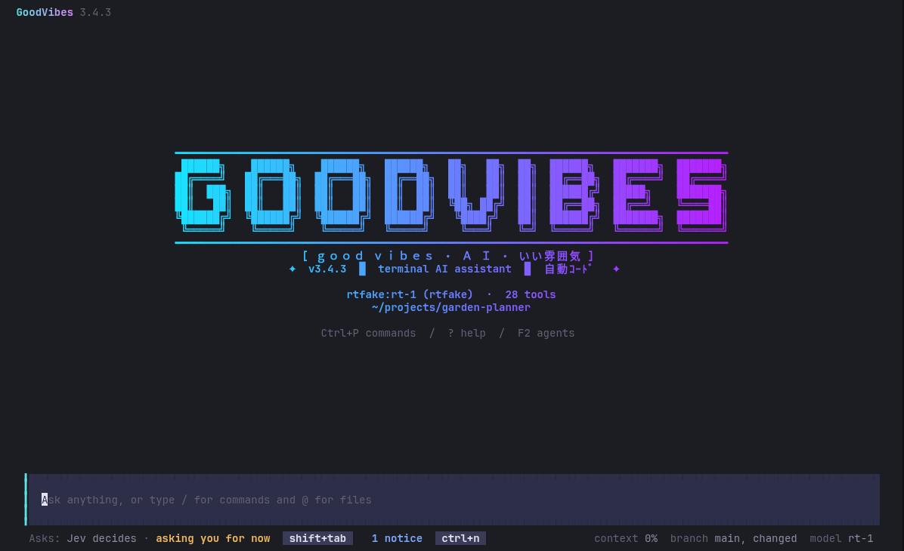
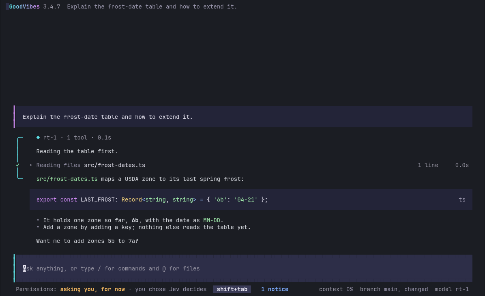

# GoodVibes terminal app (`goodvibes`)

[](https://opensource.org/licenses/MIT)

`goodvibes` is the GoodVibes terminal app for working in a project. You run `goodvibes` in a project directory and get a full-screen terminal app where you talk to a model that can read and edit your files, run shell commands and tests, search the web, and hand work off to helper agents. Reads and edits inside the project just happen; how often it stops to ask you about the rest is a setting (see [How much it asks you](../../README.md#how-much-it-asks-you)).

It talks to many model providers (OpenAI, Anthropic, Gemini, Bedrock, Copilot, OpenRouter and other OpenAI-compatible gateways, plus local servers like Ollama and LM Studio that Models and providers finds on your machine and Devices and network on your LAN), stores its settings, sessions, and secrets on your own machine (what you ask and what the tools do is sent to the models you choose, and each decision request to the decision model when one is set: [what one request sends](../../docs/decision-model-policy.md#what-one-decision-request-sends)), and shows you the token count and running cost of every turn. Background work opens in large modals over the conversation: running agents, changed files and diffs, tokens and cost.



## Install and start

Install with the [suite installer](../../docs/installation.md), which installs this app together with the personal assistant (`goodvibes-agent`), the daemon and the web UI:

```sh
curl -fsSL https://goodvibes.sh/install.sh | sh
```

Then run `goodvibes` in a project directory. When no model is ready, the first run takes three steps: choose how to get a model (a ChatGPT subscription, an API key for Anthropic, OpenRouter or another provider, or a model server found on this computer), sign in or paste the key, and start the conversation. A provider key already in your environment is simply used, with no question. When GoodVibes is set to let Jev decide and no decision model is usable yet, one more step asks who decides when GoodVibes would otherwise stop and ask you: Jev (paste a TypeSafe key, checked with one request), another decision model, or Ask me. The Setup tab of System (the menu: `Ctrl+G`, then `m`) sets up everything else one topic at a time, and its `Run first-run again` opens the three steps again. The [getting started guide](docs/getting-started.md) covers providers and keys in full. How often you are asked, and the optional decision model, are explained in the [decision-model policies](../../docs/decision-model-policy.md).

---

## A 60-second tour

### The conversation loop



Tool calls stream inline as the model makes them, then their results fold into a collapsible group so a long working session stays readable. Expand any group to see what actually came back. Assistant messages render markdown, syntax-highlighted code, and inline diffs, and any block can be collapsed, bookmarked, copied, or saved to a file.

The footer keeps an honest running total: fresh input tokens separated from cache reads, output tokens, the estimated cost so far, and how much of the context window is used. When a model's price is not in the catalog, the cost is reported as unavailable rather than guessed.

### Permissions and workspace trust


When you open a directory that brings hooks or tool servers (MCP) of its own, GoodVibes asks, as it opens and before anything runs, how much it is allowed to do there, with the cursor on "Keep restricted", so Enter pressed at once trusts nothing; a directory with none of its own is trusted without a question, since trusting it would let nothing run that your permission setting does not already govern. Restricted is read-only. The model can look around, but writes and commands are refused until you trust the workspace. Until then a `hooks.json` in the workspace is not loaded and the MCP servers its `.mcp/mcp.json` or `.goodvibes/mcp.json` name do not start. The decision is kept in your own workspace register; a project cannot mark itself trusted. The question names the folder and the hooks and tool-server files of its own it found; This folder, in Permissions and safety, changes the answer later.


After that, reads, searches, edits inside the workspace and commands a saved rule covers start at once. What only you decide (granting access, loosening a security, judgment or payment setting, a call your own "always ask me" rule covers, a change asked for from a channel, a deletion nothing keeps a copy of, sending to a new recipient, sending content derived from untrusted text, and changing what a contract requires) comes to you in every mode but `yolo` (asked, or held for the end of the run in `just-vibes`), and Jev never answers it; purchases over your limits come to you through the payment windows. Everything else is a judgment call, and `permissions.mode` decides who answers it. The default is `jev-decides`: Jev, the decision model, decides judgment calls, and with no working decision model you are asked instead. When you are asked, the card is a question in a sentence (`Run this command?`, `Change a file outside this folder?`), with the folder on the right, what it acts on (the whole command, the paths, the change), and one sentence saying what it will do. Only a call that cannot be undone is shown in red, with `This can't be undone.` You can allow it once (`y`), deny it (`n`, or `w` and a reason the model sees), or remember the decision (`a`) at whichever scope fits: this exact command, this command shape, this path, this tool, or just for the rest of the session. Enter presses the selected button, which is `No` for anything that cannot be undone and for money spent or a message sent as you; nothing that cannot be undone can be remembered.

The other modes:

- `ask-me`: Jev reads each judgment call's risk; calls it reads as critical, irreversible or security-weakening ask you, and the rest run
- `just-vibes`: nothing interrupts you; anything that needs you is held and listed at the end of the run, and Waiting for you (the menu) approves or sets it aside
- `yolo` runs every action without approval prompts, except a change asked for from a channel (authentication, containment, secret storage and payment limits still apply, and an act only you perform is refused to the model)
- `plan` allows read-only tools and refuses every mutating or exec call

Waiting for you, Decisions lists what Jev decided for you, with undo, never, always and ask. An explicit `permissions.tools.<name>` set to `deny` blocks that tool. Older saved values still load: `safe-owner`, `prompt`, `normal`, `accept-edits` and `custom` as `ask-me`, `safe-jev` and `auto` as `jev-decides`, `allow-all` as `yolo`. How the mode combines with the decision model setting is in [decision-model policies](../../docs/decision-model-policy.md#how-much-you-are-asked).

`Shift+Tab` cycles the mode for the current session only, and asks before switching to `yolo`; the saved default is set in `/settings` (When GoodVibes asks), and `--just-vibes` or `--yolo` picks one for a single launch. The Plan mode row of This conversation in Permissions and safety toggles plan mode directly.

### Models and providers


Models come from a live catalog, so the picker lists far more than a hardcoded set, filterable by search, price, capability, and availability. Each tab lists only models the catalog says read and write text, with models it does not describe after them, marked `not in the catalog`; each row shows its price tier (`free`, `paid`, `subscription`) when it is known, and the detail says how long ago the provider's list was read. The picker opens on Main chat, the one choice most people make; the optional jobs sit behind `Other jobs (optional) ▸` (Tab reaches them): Side work (a cheaper model for side jobs), Tool work, Spoken replies, the Decision model and the Search index, each of which can point somewhere different. The filter keys sit under the search field with what each is set to (`ctrl+t price: any`, `ctrl+a all models`, ...).

The `synthetic` provider groups the same model across every backend that serves it into one entry. Pick it and requests route to whichever backend is healthy, failing over on rate limits and transient errors without changing the model you chose, and without ever crossing the free, paid, and subscription boundaries. Any OpenAI-compatible API can be added as a custom provider by dropping a JSON file in `~/.goodvibes/tui/providers/`. It is hot-reloaded. See [docs/providers-and-routing.md](docs/providers-and-routing.md).

### Your agents


Work that is not conversation opens in modals instead of scrolling past in the transcript. Your agents, opened with `F2`, `Ctrl+O` or `/agents`, is the same panel in this app and in the Agent. It lists what is waiting for you first (the agent and what it asks; Enter brings its card to the front), then each running agent with what it is doing, the agents that finished this session, and what is scheduled, with the platform's own background services behind one line (`Background services  N healthy ›`) and an unhealthy one listed by itself. You can open a running agent to watch its live tail or steer it, back out with `Esc` without stopping it, stop it and what it started with `s` or `Ctrl+X` (it asks first), start a new one with `n`, pause or resume a schedule with `p`, and archive finished work. Money's Spending tab (the menu, `Ctrl+G` then `m`, or a click on the cost in the status bar) shows this conversation's context pressure, tokens, cost, turns and agents above what the daemon spent; Changes (`/changes`) shows changed files with a tinted diff, a semantic summary, hunk staging and review comments; the System place's Notices tab (`Ctrl+N`) keeps every notice. Notices no longer take over the status bar: they wait in a count there (`2 notices`).

### Everything else is a command


Press `?` on an empty prompt, `Ctrl+P` or `/help` for one searchable list of everything you can do: every command, view and setting, with the keyboard shortcuts at the end. Every slash command is guided: typing it alone opens a short list of what it can do, and an action with blanks opens a form that shows the line it will run. Each command has one name and no short aliases. The same list is generated into [docs/commands-reference.md](docs/commands-reference.md); the commands removed or renamed when each command got one name (3.3.2) are listed in the [3.3.2 release notes](../../docs/releases/3.3.2.md#removed-and-renamed-commands).

### Keys worth knowing on day one

| Key | Does |
| --- | --- |
| `Enter` / `Shift+Enter` | Send the message / insert a newline |
| `?` | The list of every command and key (on an empty prompt) |
| `@` | File picker: insert a path into the prompt |
| `Tab` | Complete a path, or toggle collapse on the nearest block |
| `Ctrl+F` | Search the conversation |
| `Ctrl+Y` / `Ctrl+S` | Copy / save the nearest block |
| `Ctrl+P` / `Ctrl+K` | The same list as `?`: search and run any command, view or setting |
| `F2` / `Ctrl+O` | Open or close Your agents |
| `Ctrl+N` | Open the notices the status bar counts |
| `Ctrl+G` | The leader: the next key completes a two-key shortcut, and the screen lists every key that can follow |
| `Ctrl+G` `m` | The menu of every place (Waiting for you, Automation, Keys, ...) |
| `Ctrl+G` `r` / `o` / `i` | On a failed turn: try again, use another model, show the details |
| `Shift+Tab` | Cycle this session's permission mode (asks before `yolo`; the saved default is unchanged) |
| `Ctrl+G` `n` / `Ctrl+G` `p` | With the session chips showing: the next / previous agent or process |
| `Esc` | One step back per press: close the top modal (one level), clear the composer, leave an agent or process view (never stops it), or interrupt main's turn. The status bar names what the next `Esc` does |
| `Ctrl+X` | Inside an agent or process view: stop it (press twice to confirm) |
| `Ctrl+C` | Clear input, cancel a running turn. Press twice to quit |

Every key the program acts on can be changed, in the System place's Keys tab (`Ctrl+G` `m`, then System) or in `~/.goodvibes/tui/keybindings.json`, `Tab`, `Enter`, `Esc` and the arrows included; `/help keys` shows what is currently bound. Each place's own letters are keys of the table too, listed in the Keys place under the place's name. Two keys are fixed: `?` (help) and `@` (file picker). The permission-mode cycle (`Shift+Tab`) is the rebindable `cycle-permission-mode`. The full reference is in [docs/tools-and-commands.md](docs/tools-and-commands.md).

---

## What's in the box

Each row links to the page that documents it. The product's own `?` list (`/help`) is always the current authority.

| Area | What you get | Docs |
| --- | --- | --- |
| Models and routing | Native, OpenAI-compatible, and gateway providers; local inference-server discovery; synthetic failover groups; per-role model targets; custom provider JSON | [providers-and-routing.md](docs/providers-and-routing.md) |
| Tools | File read/write/edit/find, shell exec, fetch, web search, code analysis and inspection, agents, workflows, bounded REPL/query runtimes | [tools-and-commands.md](docs/tools-and-commands.md) |
| Slash commands | The full generated command reference, by category | [commands-reference.md](docs/commands-reference.md) |
| Keyboard | The complete binding reference, and how to rebind | [tools-and-commands.md](docs/tools-and-commands.md) |
| Agents and workflows | Built-in and custom archetypes, spawning, git worktree isolation, automation and scheduled jobs | [tools-and-commands.md](docs/tools-and-commands.md) |
| Extending it | Hooks and hook chains, the plugin manifest and API, MCP servers, the curated marketplace | [tools-and-commands.md](docs/tools-and-commands.md) |
| Diagnostics | Evaluation suites, deterministic replay, failure reports (System, Health), telemetry | [tools-and-commands.md](docs/tools-and-commands.md) |
| CLI flags | Session lifecycle (`--continue`, `--resume`, `--fork`), non-interactive mode, output formats, host selection | [cli-flags.md](docs/cli-flags.md) |
| Knowledge and memory | Session and durable memory, a structured knowledge store with connectors and extractors, embeddings and retrieval, artifacts, multimodal analysis | [knowledge-artifacts-and-multimodal.md](docs/knowledge-artifacts-and-multimodal.md) |
| Session durability | Saved session after every turn plus a crash snapshot at each turn moment, offered at the next start | [session-durability.md](docs/session-durability.md) |
| Planning | Conversational planning loop, project-scoped knowledge spaces, readiness evaluation, the Planning modal | [project-planning.md](docs/project-planning.md) |
| Sharing and export | "Save this session as a file" (This conversation) and "upload for a link" (Sessions) to HTML, JSON, or Markdown with redaction, a Gist link, and clipboard options | [share-command.md](docs/share-command.md) |
| Daemon and services | Connecting to the standalone GoodVibes daemon, browser operator surface, background service and autostart, inbound TLS, outbound trust | [deployment-and-services.md](docs/deployment-and-services.md) |
| Remote access | A worked home-server setup: always-on daemon, browser access, TUI over SSH, reachability and TLS | [remote-access.md](docs/remote-access.md) |
| Channels and API | Slack, Discord, Telegram, Matrix, webhook and other surfaces; the shared reply pipeline; remote peers and node hosts; the control-plane HTTP and streaming API | [channels-remote-and-api.md](docs/channels-remote-and-api.md) |
| Voice | Live spoken answers (System place, This session and Voice), TTS and STT providers, streaming voice API | [voice-and-live-tts.md](docs/voice-and-live-tts.md) |
| Integrations | Home Assistant surface, Cloudflare Workers/Queues batch, GitHub Action | [homeassistant-surface.md](docs/homeassistant-surface.md) · [cloudflare-batch.md](docs/cloudflare-batch.md) · [github-action.md](docs/github-action.md) |

Full index: [docs/README.md](docs/README.md).

---

## Configuration

Settings are layered. Later layers win:

1. built-in defaults
2. global settings: `~/.goodvibes/tui/settings.json`
3. project overrides: `.goodvibes/tui/settings.json`
4. CLI and runtime overrides

Edit them live with `/settings` rather than by hand. A few of the most-reached-for keys:

| Key | Default | What it does |
| --- | --- | --- |
| `permissions.mode` | `jev-decides` | `ask-me`, `jev-decides`, `just-vibes`, `yolo`, or `plan` |
| `provider.model` | `openrouter:openrouter/free` | Active model for main chat |
| `provider.reasoningEffort` | `medium` | Reasoning depth on models that support it |
| `display.theme` | `goodvibes` | Color theme |
| `display.stream` | `true` | Stream responses token by token |
| `display.lineNumbers` | `off` | Line numbers: `off`, `code`, or `all` |
| `display.showThinking` | `false` | Show model thinking traces |
| `behavior.autoCompactThreshold` | `80` | Context percentage before auto-compact runs |
| `helper.enabled` | `false` | Route grunt work to a cheaper helper model |
| `daemon.enabled` | `true` | Adopt a local session daemon on loopback; off makes no adoption attempt |

The wider key table, the permission modes, and the hand-edited TUI namespaces (checkpoint root guard, scriptable statusline, session behavior, launch-time self-update) are in [docs/configuration.md](docs/configuration.md).

### Where things are stored

Everything lives in plain files, split between the per-user `~/.goodvibes/tui/` tree and the project's own `.goodvibes/` directory:

| Path | What lives there |
| --- | --- |
| `~/.goodvibes/tui/settings.json` | Global settings |
| `.goodvibes/tui/settings.json` | Project settings overriding the global layer |
| `~/.goodvibes/tui/secrets.enc` or `.goodvibes/tui/secrets.enc` | Encrypted secrets, global or per project |
| `~/.goodvibes/tui/providers/*.json` | Custom provider definitions, hot-reloaded |
| `~/.goodvibes/tui/keybindings.json` | Keybinding overrides |
| `~/.goodvibes/tui/services.json` | The service registry (a project's `.goodvibes/tui/services.json` adds only services whose credentials are keys in your secret store) |
| `.goodvibes/tui/automation-*.json` | Scheduled jobs and the rest of the automation store |
| `.goodvibes/agents/*.md` | Agent archetypes |
| `.goodvibes/mcp.json` | MCP server definitions (a project's start only once the workspace is trusted) |
| `hooks.json` (project root) | Hooks and hook chains (loaded only once the workspace is trusted) |
| `.goodvibes/` (rest) | Sessions, artifacts, and other project runtime state in the working directory |

---

## A note on cost

Free-tier synthetic models can cascade to the next-best free model when every backend for the current one is exhausted, and free, paid, and subscription tiers are never mixed. This system is not perfect, and there are ways it could result in charges accruing.

This includes but is not limited to when a provider moves a model from free to paid and you have kept the session running for longer than 24 hours without refreshing the model list. The system will not know that the model is now a paid model.

Refreshes happen automatically when a new session is started or resumed after the 24-hour catalog TTL expires. For long-running sessions, please ensure that the models are refreshed daily.

Paid and subscription models never move to a model you did not choose. A failed model is tried again only as the same model on another sign-in of its provider (OpenAI: the subscription, then the API key), and then only as the models you list in `provider.fallbackModels`, in your order; with none listed, the turn stops and says why. When every backend of a paid synthetic model is exhausted, GoodVibes says so and offers to wait out the cooldown, change model, or move to a free model. Full failover behavior: [docs/providers-and-routing.md](docs/providers-and-routing.md).

---

## Reference

The sections below describe specific commands in detail.

### Purchase approval and veto windows

The purchases waiting for you are on the Purchases tab of Waiting for you (the
menu of places): select one, read its notice and deadline, then press the
answer it offers (approve or deny, go ahead now or cancel), stop a checkout, or
type a card's security code on the hidden line. An answer already sent may
still complete on the host.

Cards, the billing and shipping addresses and the purchases you allow ahead of
time are in Money. On its Cards tab, `n` ("Add a card") is a form with every
card field hidden, sent to the daemon in one `payments.cards.create` request;
the tab lists the cards the daemon holds (label, kind, brand, last four digits,
expiry; never the number, CVV or name) and `x` removes one.

### Work on the host

The Work place (the menu's "Work and agents" row, or `/work`) shows your work,
held and run by the daemon: each piece with where it stands, what done means, its
plan as steps and its results, and the keys that apply to it (`s` start, `x` stop,
`g` go on, `a` answer what it asks, `t` run a failed step again, `b` what it may
spend, `v` check). `n` asks for new work with what done means; the Checklist list
is the project's running list of things to do. Opening it never starts anything. How a request whose answer was lost is recovered, and the
limits on a request, are in [docs/native-work.md](docs/native-work.md).

### Conversation input

Composer messages and `goodvibes --prompt '<text>'` go directly to the selected
conversation model. Jev does not approve, reject or reroute these messages.
Messages submitted during a response are queued. Composer file references,
paste content and supported images are passed through to the conversation.

### Asking for work in your own words

"Ask in your own words" in the Work place sends your exact words to the host's
intake: the host decides whether they are an answer or a piece of work, and
admitted work runs on the daemon. Your words are kept exactly as typed, including
extra leading spaces, trailing whitespace, line breaks and Unicode; a model or a
script cannot send a request in your name. Input waiting for the host to admit it
can be seen, sent again, gone on with or dropped (see
[docs/native-work.md](docs/native-work.md)).

### TUI host credentials

Native `/work`, headless intake and legacy-import reads use a TUI-owned device credential bound to the exact configured daemon origin when there is one. For the daemon on this machine (a loopback origin whose operator token file is yours) no pairing is needed: the TUI presents the operator token it already holds, and the daemon treats it as the owner's own machine. For a daemon on another machine, review `goodvibes host pair --bootstrap-shared` in an owner terminal; add `--apply` only after reviewing the persistent administrative scope. Use `--url <origin>` for a one-command endpoint override. That key is never your device. To make this terminal your own device: in the Devices and network place, Pair something, This program with its daemon, type the sign-in code your own screen shows where you are signed in as yourself; companion pairing is Pair something, A phone or another device. See [host pairing and recovery](docs/host-pairing.md).

---

## How it fits with the rest of GoodVibes

How the terminal app, the Agent, the daemon and the web UI fit together, what
runs where and why: [How GoodVibes works](../../docs/how-goodvibes-works.md).

---

## Stability

GoodVibes ships as one suite version. Changes, including renamed settings and removed commands, are recorded in the [suite changelog](../../packages/engine/CHANGELOG.md) and the [release notes](../../docs/releases/), one file per release.

## License

MIT
