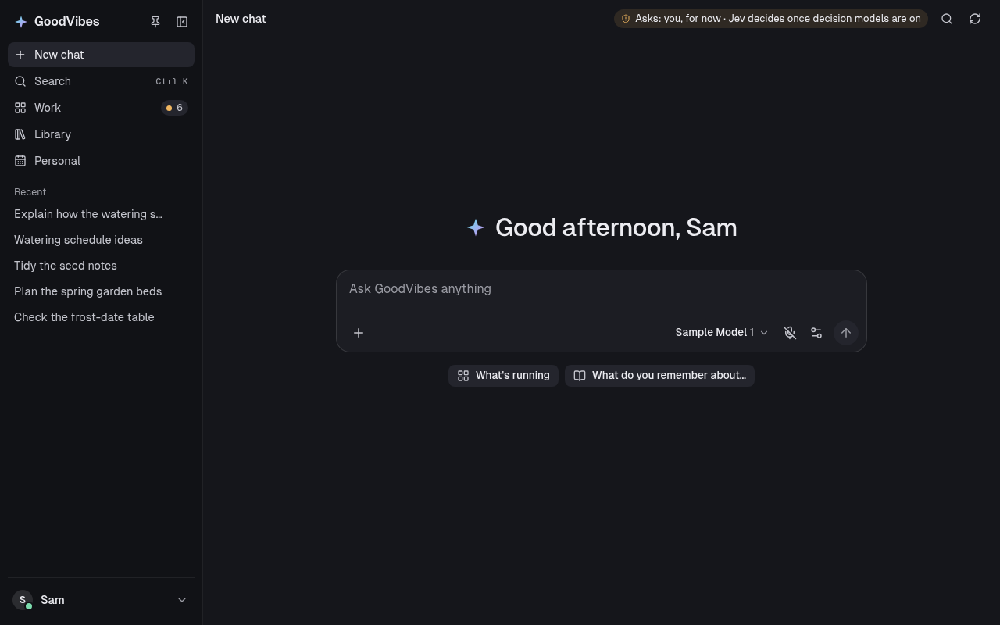
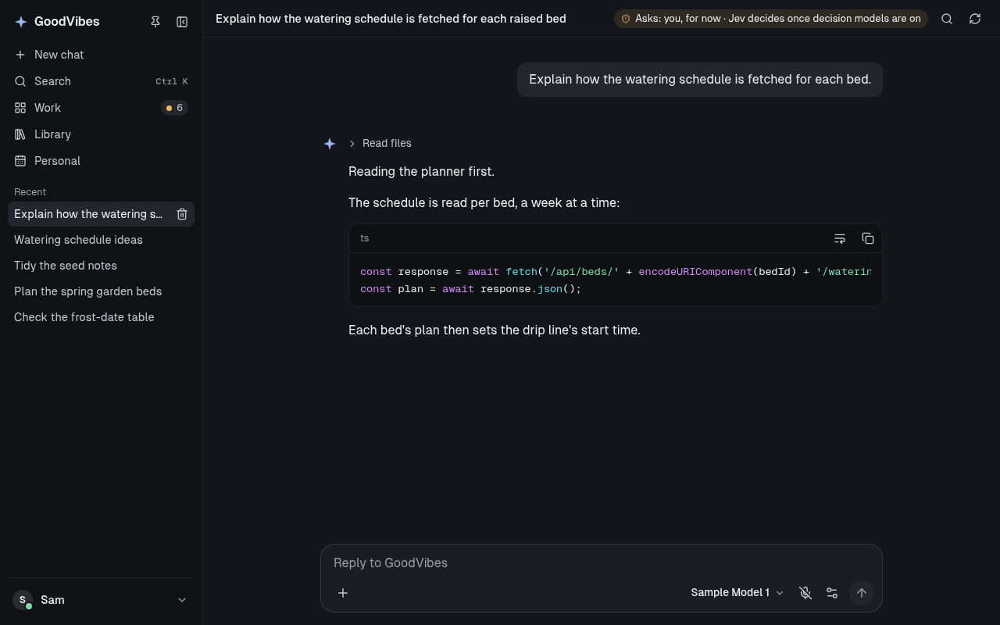
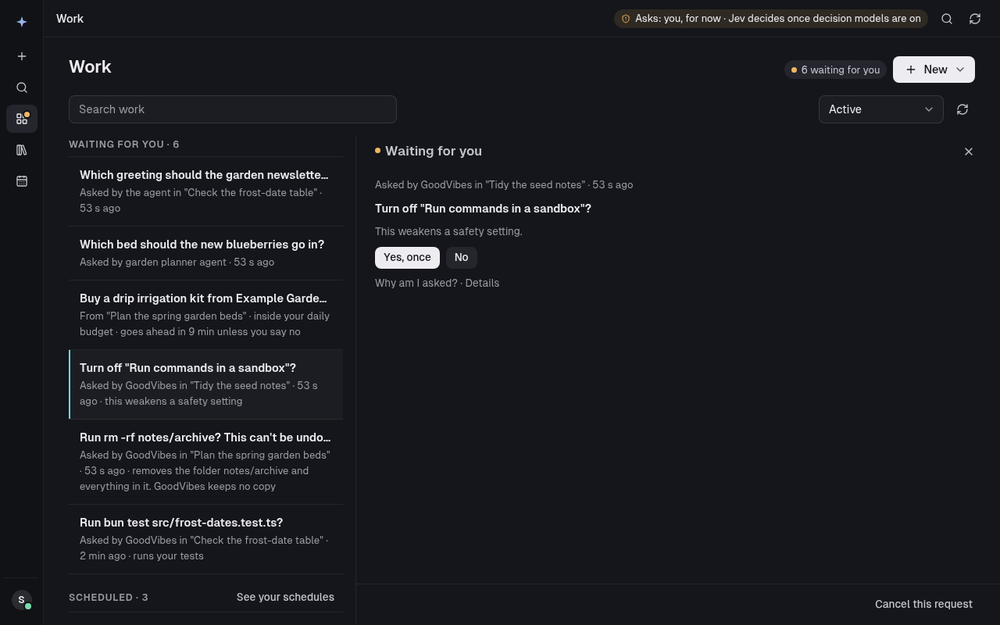
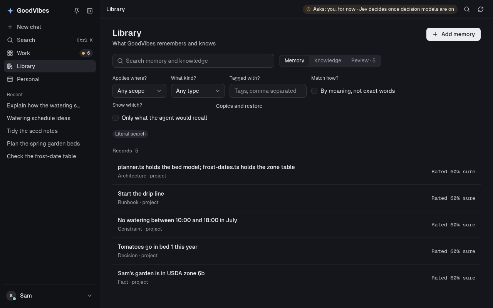
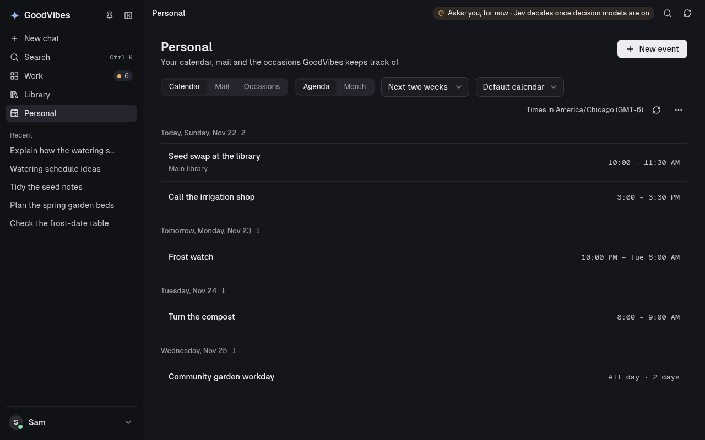
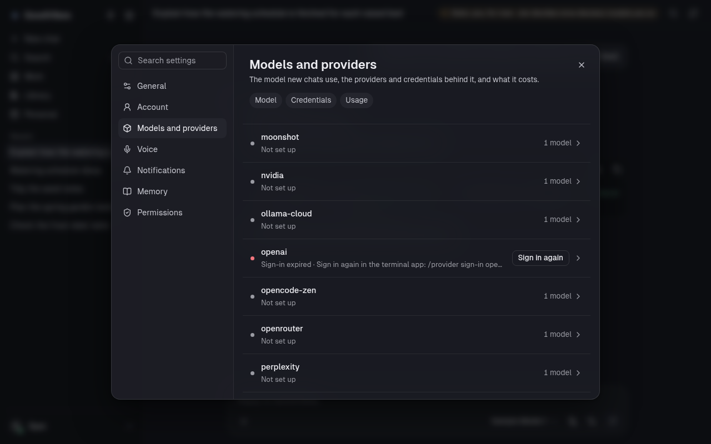
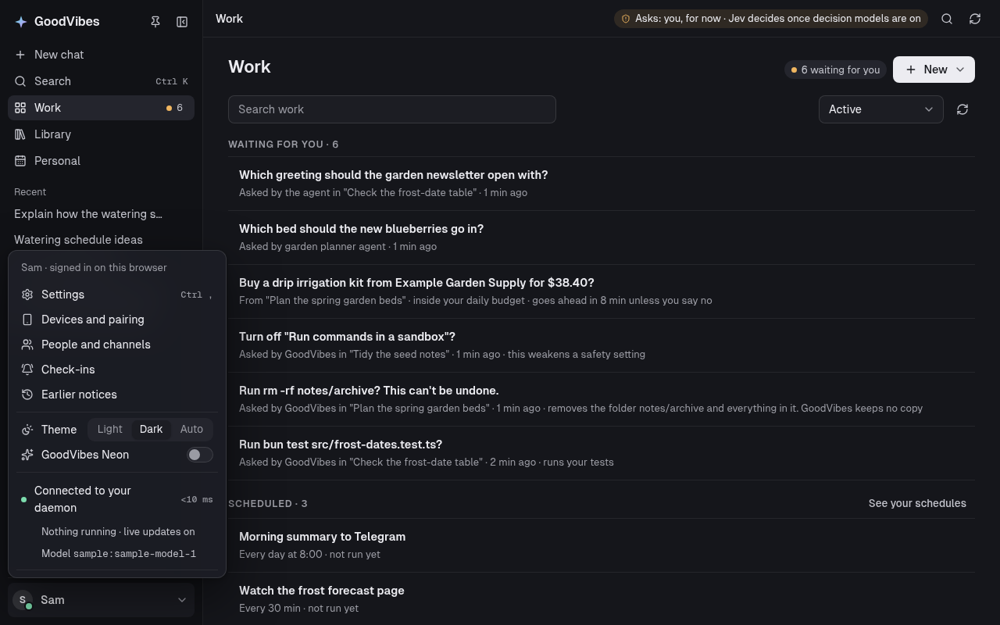
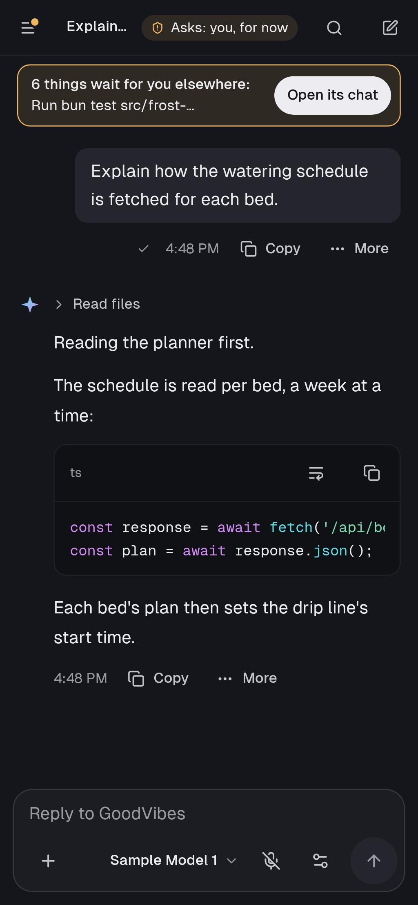
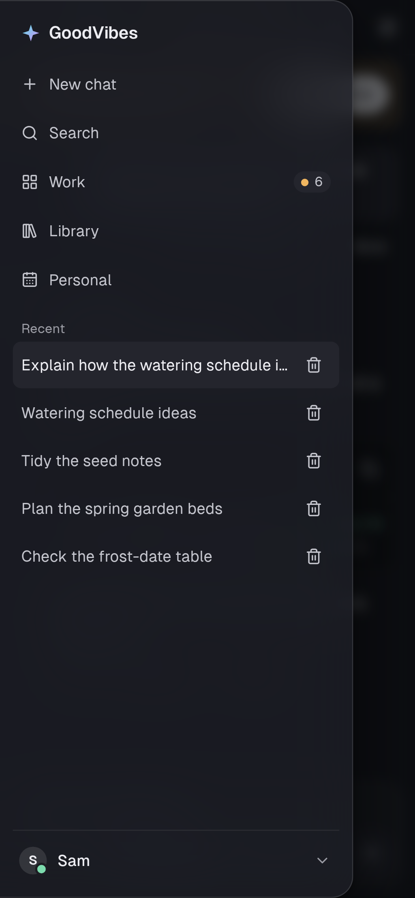
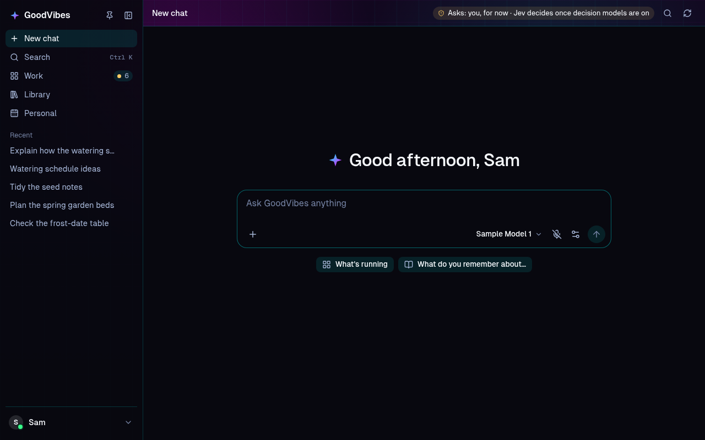

# Screenshot tour

These screenshots were taken from a real daemon seeded with sample chats, asks,
memories and schedules for a garden-planning project, dark theme, at desktop
(1280x800) and phone (390x844) sizes, with a scripted model; the calendar's
events are sample answers. Your own chats, providers and daemon state will
differ, so treat these as layout references rather than fixed data.

GoodVibes has four places in the sidebar (Chat, Work, Library, Personal), a
settings dialog, and an account menu. Links from earlier versions (`?view=fleet`,
`?view=memory`, `?view=admin` and the rest) redirect to the matching place; see
[operator-guide.md](operator-guide.md#navigation).

## New chat

A new chat opens on a greeting, one composer with the model picker, voice and
attachments, and starting points for the other places. A starting point that
needs mail or a calendar is shown only when that account is connected. Recent
chats are listed in the sidebar, newest first.

## A conversation

Replies stream with syntax-highlighted Markdown and per-block copy. Tool
activity folds into a single quiet line ("Read files") that expands on demand.
Each code block has a wrap button beside its copy button.

## Work

Work lists everything working for you in one place, grouped as Waiting for you,
Running now, Scheduled and Finished, with the platform's own services behind one
line. An item opens in a detail pane beside the list (an ask here, as its card:
the question in a sentence, what it will do, and the choices). While the detail
is open the sidebar folds to an icon rail.

## Library

Library holds Memory, Knowledge and Review. Memory shows each record's type,
scope and how sure it is said to be (a rating given when it was saved or
reviewed, not a measurement), and says which search mode actually ran. Each
filter sits under the question it answers. Knowledge shows what is known by
subject, each fact with where it came from; Review is everything waiting on a
human call.

## Personal

Personal holds Calendar, Mail and Occasions. The calendar's agenda shows each
event from start to end, names the time zone once, picks dates as Today, This
week, Next two weeks or This month, and names each calendar. A daemon without a
calendar or mail account says so, naming the accounts it has and why none can
be read, rather than showing an empty page.

## Settings

Settings is a dialog with seven pages (General, Account, Models and providers,
Voice, Notifications, Memory, Permissions) and a search box. Models and
providers shows the current model new chats use and each provider's sign-in
state. A provider whose sign-in expired carries a Sign in again button that
copies the terminal command which signs it in again. Permissions opens with the
four permission modes as cards. The chip at the right of the header says what
is in force and what you chose, and opens that page.

## Account menu

The account button at the foot of the sidebar opens a menu with Settings,
Devices and pairing, People and channels, Check-ins, Earlier notices, the theme
switch, the GoodVibes Neon toggle, your connection to the daemon in plain
words, and Sign out.

## On a phone

At phone width the sidebar becomes a drawer behind the header's menu button or a
swipe from the left edge. The same four places are in it, with the count of
items that need you beside Work. A long chat title is cut short beside the
header chip; a banner says when something in another chat waits for you; each
message shows Copy with its word and keeps the rest under More.

## GoodVibes Neon

GoodVibes Neon is an opt-in theme, turned on under Settings, General or from the
account menu. It never replaces a theme you chose.

## Not shown

Mail, Occasions, the Review list, check-ins, the phone node page and the
pairing hand-off do not have captures here. Their behavior is documented in
[operator-guide.md](operator-guide.md).
